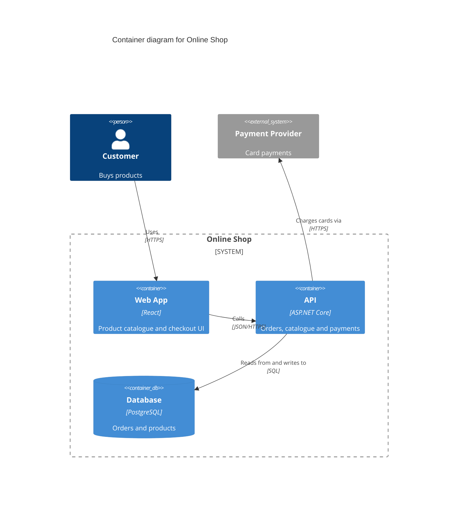

# C4 diagram

Draw architecture diagrams following [the C4 model](https://c4model.com/) and [general/documentation.md](../../general/documentation.md).

## 1. Choose levels and format

- **Levels**: by default, draw a **System Context** and a **Container** diagram. Draw a **Component** diagram only for one named container, and only when asked or clearly useful ([C4 diagrams](https://c4model.com/diagrams)).
- **Format**: by default use **Mermaid** C4 syntax in Markdown, which GitHub renders. Note that Mermaid's C4 support is [experimental](https://mermaid.js.org/syntax/c4.html). Use **Structurizr DSL** if the user wants one model with many views, or if the repository already uses it ([Structurizr](https://structurizr.com/)).
- If the repository already has diagrams, update them in their existing format rather than starting new ones.

## 2. Gather the facts

From the code:

- **Containers** (separately deployable or runnable units): services, web and mobile apps, game clients and servers, workers, functions, databases, queues and caches. Look at Dockerfiles, compose files, Kubernetes manifests, IaC, solution and project files, and `package.json` workspaces.
- **Relationships**: HTTP clients and base URLs, message topics, connection strings, SDK usage.
- **External systems**: third-party APIs, identity providers, payment, analytics, platform services.

From the user, ask about what code can't show: who the users are (people and roles), which external systems belong to other teams, and the purpose of each system in one sentence.

## 3. Apply the notation rules

From [C4 notation](https://c4model.com/diagrams/notation):

- Every diagram has a **title** that states its type and scope.
- Every element has a name, a type and a short description. Containers and components also list their technology.
- Every relationship is **directed and labelled** with its intent, and with the technology or protocol where relevant (for example "Reads orders from", "SQL/TCP").
- Include a key or legend. If the tool doesn't draw one, write a short one under the diagram.
- Keep each diagram readable: about 20 elements at most. Split it if it gets bigger.

## 4. Write the diagram

Mermaid example:

````markdown

````

Structurizr DSL example:

```
workspace "Online Shop" {
    model {
        customer = person "Customer" "Buys products"
        shop = softwareSystem "Online Shop" {
            web = container "Web App" "Product catalogue and checkout UI" "React"
            api = container "API" "Orders, catalogue and payments" "ASP.NET Core"
            db = container "Database" "Orders and products" "PostgreSQL" "Database"
        }
        payments = softwareSystem "Payment Provider" "Card payments" "External"
        customer -> web "Uses" "HTTPS"
        web -> api "Calls" "JSON/HTTPS"
        api -> db "Reads from and writes to" "SQL"
        api -> payments "Charges cards via" "HTTPS"
    }
    views {
        systemContext shop { include * autolayout lr }
        container shop { include * autolayout lr }
    }
}
```

## 5. Save and check

- Save to the repository's existing architecture docs location, or else to `docs/architecture/c4.md` (Mermaid) or `docs/architecture/workspace.dsl` (Structurizr). Ask before overwriting an existing file.
- If the Mermaid CLI (`mmdc`) or the Structurizr CLI is available, render the diagram to check the syntax. Otherwise re-read the syntax carefully against the examples above.
- List the assumptions you made, such as inferred relationships or guessed descriptions, so the user can correct them.
